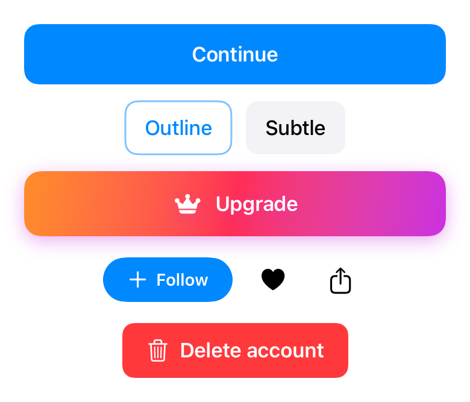
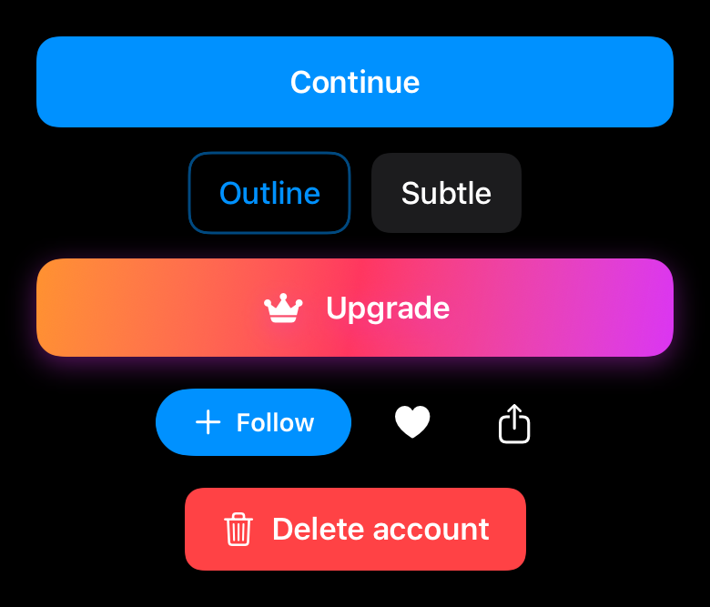
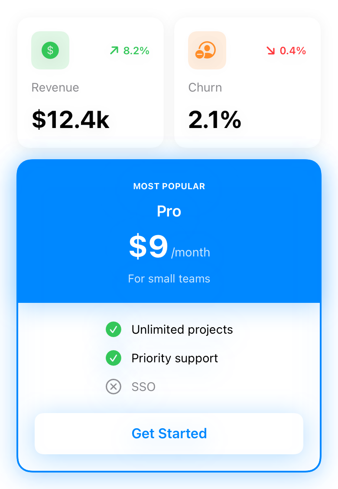
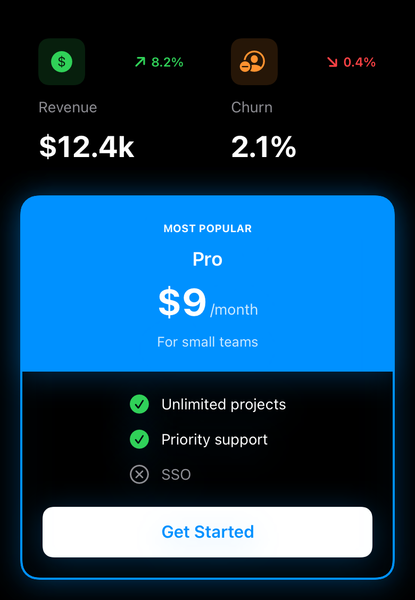
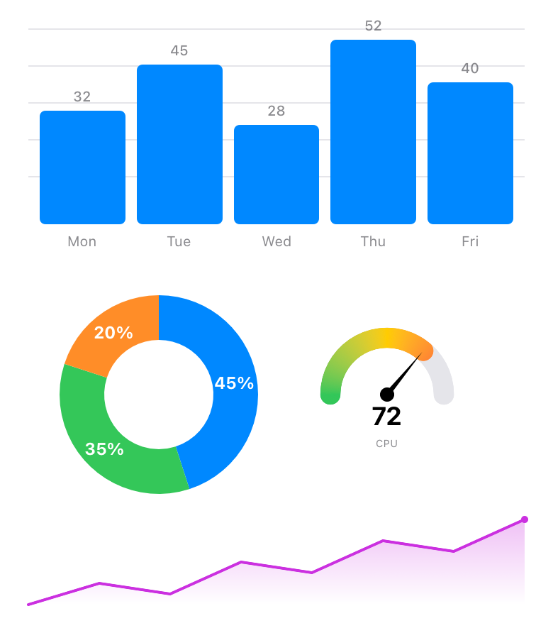
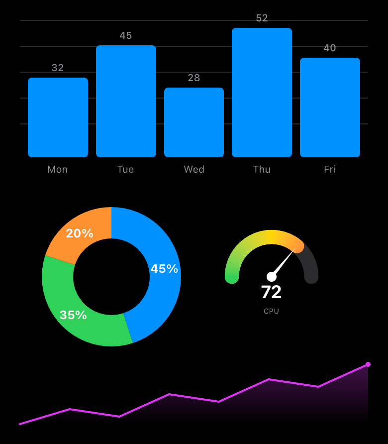
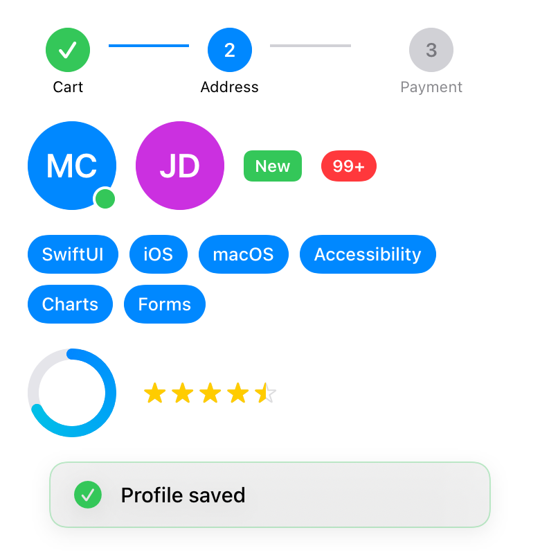
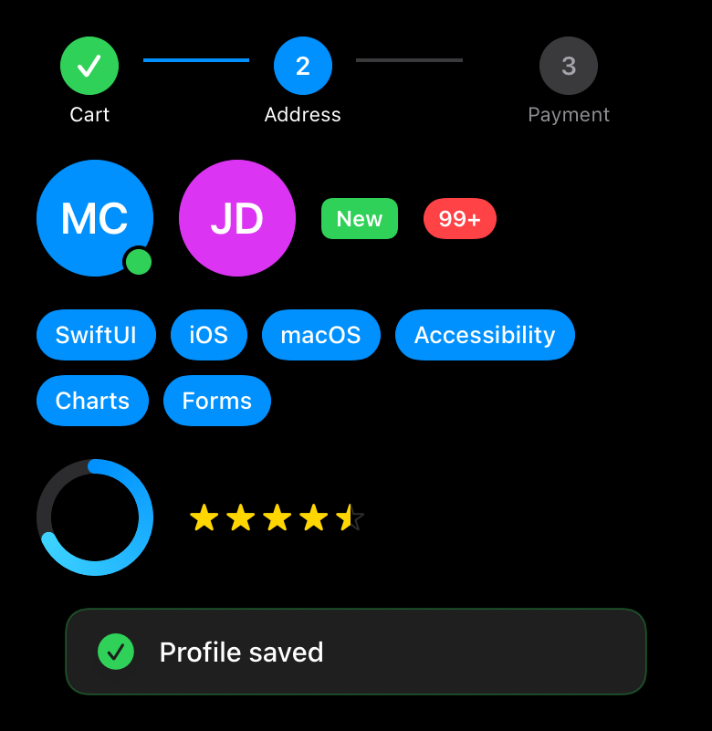

<!-- i18n-source: README.md@70896b24aa3368f59c03d971679f11b95e994eb8 status=reviewed -->
<!-- brand:start -->

<p align="center"><picture><source media="(prefers-color-scheme: dark)" srcset="https://raw.githubusercontent.com/muhittincamdali/SwiftUI-Components/main/.github/brand/banner-es-dark.svg"><source media="(prefers-color-scheme: light)" srcset="https://raw.githubusercontent.com/muhittincamdali/SwiftUI-Components/main/.github/brand/banner-es-light.svg"></picture></p>

<!-- lang-selector:start -->
<p align="center"><a href="README.md">English</a> · <a href="README.tr.md">Türkçe</a> · <a href="README.zh-CN.md">简体中文</a> · <a href="README.ja.md">日本語</a> · <a href="README.ko.md">한국어</a> · <a href="README.es.md">Español</a> · <a href="README.de.md">Deutsch</a> · <a href="README.fr.md">Français</a> · <a href="README.pt-BR.md">Português (Brasil)</a> · <a href="README.ru.md">Русский</a></p>
<!-- lang-selector:end -->

<p align="center">
<a href="https://github.com/muhittincamdali/SwiftUI-Components/actions/workflows/ci.yml"></a>
<a href="https://github.com/muhittincamdali/SwiftUI-Components/releases"><picture><source media="(prefers-color-scheme: dark)" srcset="https://raw.githubusercontent.com/muhittincamdali/SwiftUI-Components/main/.github/brand/badge-version-dark.svg"><source media="(prefers-color-scheme: light)" srcset="https://raw.githubusercontent.com/muhittincamdali/SwiftUI-Components/main/.github/brand/badge-version-light.svg"></picture></a>
<a href="https://github.com/muhittincamdali/SwiftUI-Components/blob/main/Package.swift"><picture><source media="(prefers-color-scheme: dark)" srcset="https://raw.githubusercontent.com/muhittincamdali/SwiftUI-Components/main/.github/brand/badge-platforms-dark.svg"><source media="(prefers-color-scheme: light)" srcset="https://raw.githubusercontent.com/muhittincamdali/SwiftUI-Components/main/.github/brand/badge-platforms-light.svg"></picture></a>
<a href="https://github.com/muhittincamdali/SwiftUI-Components/blob/main/Package.swift"><picture><source media="(prefers-color-scheme: dark)" srcset="https://raw.githubusercontent.com/muhittincamdali/SwiftUI-Components/main/.github/brand/badge-language-dark.svg"><source media="(prefers-color-scheme: light)" srcset="https://raw.githubusercontent.com/muhittincamdali/SwiftUI-Components/main/.github/brand/badge-language-light.svg"></picture></a>
<a href="https://github.com/muhittincamdali/SwiftUI-Components/blob/main/LICENSE"><picture><source media="(prefers-color-scheme: dark)" srcset="https://raw.githubusercontent.com/muhittincamdali/SwiftUI-Components/main/.github/brand/badge-license-dark.svg"><source media="(prefers-color-scheme: light)" srcset="https://raw.githubusercontent.com/muhittincamdali/SwiftUI-Components/main/.github/brand/badge-license-light.svg"></picture></a>
</p>

<p align="center">
<a href="#inicio-rápido"><picture><source media="(prefers-color-scheme: dark)" srcset="https://raw.githubusercontent.com/muhittincamdali/SwiftUI-Components/main/.github/brand/button-start-es-dark.svg"><source media="(prefers-color-scheme: light)" srcset="https://raw.githubusercontent.com/muhittincamdali/SwiftUI-Components/main/.github/brand/button-start-es-light.svg"></picture></a>
<a href="https://muhittincamdali.github.io/SwiftUI-Components/documentation/swiftuicomponents/"><picture><source media="(prefers-color-scheme: dark)" srcset="https://raw.githubusercontent.com/muhittincamdali/SwiftUI-Components/main/.github/brand/button-docs-es-dark.svg"><source media="(prefers-color-scheme: light)" srcset="https://raw.githubusercontent.com/muhittincamdali/SwiftUI-Components/main/.github/brand/button-docs-es-light.svg"></picture></a>
<a href="https://github.com/muhittincamdali/SwiftUI-Components/tree/main/Examples"><picture><source media="(prefers-color-scheme: dark)" srcset="https://raw.githubusercontent.com/muhittincamdali/SwiftUI-Components/main/.github/brand/button-examples-es-dark.svg"><source media="(prefers-color-scheme: light)" srcset="https://raw.githubusercontent.com/muhittincamdali/SwiftUI-Components/main/.github/brand/button-examples-es-light.svg"></picture></a>
</p>

> Esta es una traducción del README en inglés. Si hay diferencias, la versión en inglés es la vigente.

<!-- brand:end -->

Un paquete de Swift con vistas de SwiftUI listas para usar en iOS 17+ y macOS 14+: botones,
tarjetas, gráficos, campos de formulario, listas, superposiciones, indicadores de carga y avisos.
Está pensado para desarrolladores de apps que quieren un componente que funcione hoy en lugar de
escribirlo desde cero. Cada componente es una `View` de SwiftUI normal que se configura con su
inicializador, así que puedes usar uno o dos sin adoptar un sistema de temas ni una arquitectura.
El paquete no tiene dependencias.

## Lo más destacado

- **220 vistas y 12 modifiers**: contados en el código fuente y repartidos en 13 carpetas, desde
  `PrimaryButton` hasta `CreditCardInput` y `GaugeChart`.
- **iOS y macOS con el mismo código**: los detalles que solo existen en UIKit recurren al
  comportamiento más parecido de AppKit; las
  [notas de plataforma](Sources/SwiftUIComponents/SwiftUIComponents.docc/PlatformDifferences.md)
  enumeran cada uno.
- **Modo de lenguaje Swift 6**: el paquete compila con la comprobación estricta de concurrencia y
  sin advertencias.
- **Lógica con pruebas**: la detección del número de tarjeta y la comprobación de Luhn, las fechas
  de caducidad, el formato de teléfonos, el salto de línea de `FlowLayout`, la geometría de los
  gráficos, la paginación y las colas de avisos están cubiertos por 56 pruebas de Swift Testing que
  se ejecutan en macOS y en un simulador de iPhone.
- **Ejemplos que compilan**: cada fragmento de código de abajo procede de la
  [app de ejemplo](Examples/ComponentGallery), que la CI compila para iOS y macOS.

### Qué incluye

| Categoría            | Ejemplos                                                                                                                                        |
| -------------------- | ----------------------------------------------------------------------------------------------------------------------------------------------- |
| Botones (25)         | `PrimaryButton`, `SecondaryButton`, `LoadingButton`, `GradientButton`, `PillButton`, `FloatingActionButton`, `SplitButton`, `ToggleButtonGroup` |
| Tarjetas (27)        | `CardView`, `StatCard`, `PricingCard`, `ProfileCard`, `ProductCard`, `FlipCard`, `ExpandableCard`, `TestimonialCarousel`                        |
| Gráficos (19)        | `BarChart`, `LineChart`, `AreaChart`, `PieChart`, `DonutChart`, `GaugeChart`, `RingChart`, `SparklineChart`                                     |
| Formularios (21)     | `FormField`, `TextInputField`, `PasswordField`, `SelectField`, `MultiSelectField`, `SliderField`, `RangeSlider`, `OTPField`, `DateField`        |
| Entradas (13)        | `CreditCardInput`, `PhoneInput`, `PinInput`, `TimedPinInput`, `RatingInput`, `SearchBar`, `TagInput`                                            |
| Listas (18)          | `InfiniteScrollList` + `PaginatedListViewModel`, `ExpandableList`, `TreeView`, `SwipeableRow`, `ReorderableList`                                |
| Carga (16)           | `ProgressRing`, `SkeletonView`, `ShimmerView`, `DotLoader`, `PulseLoader`, `StateView`, `AsyncContentView`                                      |
| Navegación (19)      | `SegmentedControl`, `StepsIndicator`, `PageIndicator`, `BreadcrumbView`, `CustomTabBar`, `SideMenu`                                             |
| Superposiciones (13) | `BottomSheet`, `AlertDialog`, `ConfirmationDialog`, `ModalView`, `Tooltip`, `PopoverView`                                                       |
| Texto (17)           | `HighlightedText`, `ExpandableText`, `TypewriterText`, `MarqueeText`, `AnimatedCounter`, `GradientText`                                         |
| Avisos (4)           | `ToastView`, `SnackBar` + `SnackBarManager`, `Banner` + `BannerManager`                                                                         |
| Varios (27)          | `Avatar`, `Badge`, `Chip`, `Tag`, `Carousel`, `Accordion`, `CountdownTimer`, `Stopwatch`                                                        |
| Estados vacíos (1)   | `EmptyStateView`                                                                                                                                |

Disposición y modifiers: `FlowLayout` (disposición que salta de línea), `.surface()`,
`.shimmer()`, `.toast(isPresenting:message:)`, `.snackBarHost()`, `.bannerHost()`.

## Inicio rápido

**1. Añade el paquete**

En Xcode, elige **File › Add Package Dependencies…** e introduce la URL del repositorio:

```text
https://github.com/muhittincamdali/SwiftUI-Components.git
```

Pégala en el campo de búsqueda de la esquina superior derecha de la ventana. Cambia
**Dependency Rule** a **Branch**, escribe `main` y haz clic en **Add Package**. En la siguiente
ventana, elige el target de tu app junto a **SwiftUIComponents** y vuelve a hacer clic en
**Add Package**.

**2. Importa el módulo**

```swift
import SwiftUIComponents
```

Pon esta línea al principio del archivo Swift donde uses un componente, debajo de
`import SwiftUI`.

**3. Úsalo**

En una app nueva de Xcode (**File › New › Project… › App**), sustituye todo el contenido de
`ContentView.swift` por:

```swift
import SwiftUI
import SwiftUIComponents

struct ContentView: View {
    @State private var rating = 3.0

    var body: some View {
        VStack(spacing: 20) {
            Text("Rate this app")
                .font(.headline)
            RatingInput(rating: $rating)
            PrimaryButton("Send rating") {
                print("Rating: \(rating)")
            }
        }
        .padding()
    }
}
```

Pulsa **Run** (⌘R). La app muestra cinco estrellas y un botón azul; toca una estrella para cambiar
la valoración y toca el botón para imprimirla en la consola de Xcode.

## Instalación

### Swift Package Manager

En Xcode, elige **File › Add Package Dependencies…** e introduce la URL del repositorio:

```text
https://github.com/muhittincamdali/SwiftUI-Components.git
```

O añádelo a las `dependencies` de tu `Package.swift`:

```swift
dependencies: [
    .package(url: "https://github.com/muhittincamdali/SwiftUI-Components.git", branch: "main")
],
targets: [
    .target(name: "YourApp", dependencies: [
        .product(name: "SwiftUIComponents", package: "SwiftUI-Components")
    ])
]
```

Por ahora usa la rama `main`. La única versión publicada, 1.0.0 (febrero de 2026), es anterior a
los componentes actuales: en junio de 2026 se sustituyeron por código provisional, y en octubre de
2026 se restauraron, se adaptaron para compilar en iOS y macOS en el modo de lenguaje Swift 6 y
se corrigieron los errores que encontraron las nuevas pruebas. Los detalles están en
[CHANGELOG.md](CHANGELOG.md).

## Uso

Los ejemplos siguientes están copiados de
[`Examples/ComponentGallery/ComponentGallery/ReadmeSamples.swift`](Examples/ComponentGallery/ComponentGallery/ReadmeSamples.swift).
Tanto la app de ejemplo como las pruebas compilan ese archivo.

### Botones

```swift
struct CheckoutButtons: View {
    @State private var payState: LoadingButton.LoadingState = .idle

    var body: some View {
        VStack(spacing: 12) {
            PrimaryButton("Continue") {
                print("Continue tapped")
            }

            LoadingButton("Pay $9.99", state: $payState) {
                try? await Task.sleep(for: .seconds(1))
                return true // false shows the failure state
            }
        }
        .padding()
    }
}
```

### Gráficos

```swift
struct WeeklyStats: View {
    var body: some View {
        VStack(spacing: 24) {
            BarChart(data: [
                .init(value: 32, label: "Mon"),
                .init(value: 45, label: "Tue"),
                .init(value: 28, label: "Wed"),
            ])
            .frame(height: 180)

            SparklineChart(data: [3, 5, 4, 7, 6, 9], style: .gradient, lineColor: .purple)
                .frame(height: 50)
        }
        .padding()
    }
}
```

### Formulario de pago

`CreditCardInput` da formato al número mientras escribes, detecta la red de la tarjeta y valida el
número (Luhn), la fecha de caducidad, la longitud del CVV y el nombre del titular.

```swift
struct PaymentForm: View {
    @State private var number = ""
    @State private var expiry = ""
    @State private var cvv = ""
    @State private var name = ""
    @State private var canPay = false

    var body: some View {
        VStack {
            CreditCardInput(
                cardNumber: $number,
                expiryDate: $expiry,
                cvv: $cvv,
                cardholderName: $name,
                onValidationChange: { canPay = $0 }
            )
            PrimaryButton("Pay", isDisabled: !canPay) {}
        }
        .padding()
    }
}
```

Las funciones de formato y validación son públicas por si las necesitas en otro sitio:

```swift
let type = CreditCardInput.CardType.detect(from: "3782 822463 10005") // .amex
let pretty = CreditCardInput.formatCardNumber("378282246310005")     // "3782 822463 10005"
let valid = CreditCardInput.isLuhnValid("378282246310005")           // true
```

### Snackbars

```swift
struct InboxScreen: View {
    var body: some View {
        List {
            Button("Archive") {
                SnackBarManager.shared.show(message: "Conversation archived", style: .success)
            }
        }
        .snackBarHost()
    }
}
```

Los snackbars se ponen en cola y se muestran de uno en uno; `BannerManager` funciona igual con
`.bannerHost()`, salvo que un banner nuevo sustituye al actual.

### Disposición en flujo

```swift
struct TopicPicker: View {
    let topics = ["SwiftUI", "Combine", "Concurrency", "Testing", "Accessibility"]

    var body: some View {
        FlowLayout(spacing: 8) {
            ForEach(topics, id: \.self) { topic in
                Tag(topic)
            }
        }
    }
}
```

## Demo

| Claro                                                   | Oscuro                                                  |
| ------------------------------------------------------- | ------------------------------------------------------- |
|         |         |
|          |          |
|         |         |
|  |  |

Las capturas se renderizan en el simulador de iOS a partir de
[`Tests/SwiftUIComponentsTests/Gallery.swift`](Tests/SwiftUIComponentsTests/Gallery.swift)
con [`scripts/generate-screenshots.sh`](scripts/generate-screenshots.sh).

Para probar los componentes tú mismo, abre `ComponentGallery.xcodeproj` en
[`Examples/ComponentGallery`](Examples/ComponentGallery) con Xcode, elige un simulador de iPhone
o **My Mac** y pulsa **Run**. La app tiene una pantalla por cada ejemplo de arriba;
[Examples/README.md](Examples/README.md) tiene los detalles.

## Documentación

Referencia de la API y artículos:

- [Referencia de la API](https://muhittincamdali.github.io/SwiftUI-Components/documentation/swiftuicomponents/)
  (DocC, publicada en GitHub Pages desde `main`)
- Para generarla en local, usa **Product › Build Documentation** en Xcode o la línea de comandos:

```sh
xcodebuild docbuild -scheme SwiftUIComponents -destination 'generic/platform=macOS'
```

## Guías

- [Getting Started](https://muhittincamdali.github.io/SwiftUI-Components/documentation/swiftuicomponents/gettingstarted)
  — añadir el paquete, colocar un componente, mostrar snackbars y paginar una lista
  ([fuente](Sources/SwiftUIComponents/SwiftUIComponents.docc/GettingStarted.md)).
- [Collecting Card Details](https://muhittincamdali.github.io/SwiftUI-Components/documentation/swiftuicomponents/collectingcarddetails)
  — un formulario de pago con validación, y qué cubren y qué no cubren las comprobaciones
  ([fuente](Sources/SwiftUIComponents/SwiftUIComponents.docc/CollectingCardDetails.md)).
- [Platform Differences](https://muhittincamdali.github.io/SwiftUI-Components/documentation/swiftuicomponents/platformdifferences)
  — qué cambia en macOS
  ([fuente](Sources/SwiftUIComponents/SwiftUIComponents.docc/PlatformDifferences.md)).

Los artículos están en inglés.

## Requisitos

| Plataforma   | Versión mínima        |
| ------------ | --------------------- |
| iOS          | 17                    |
| macOS        | 14                    |
| Herramientas | Swift 6.2 · Xcode 26+ |

La CI compila con el Xcode predeterminado de la imagen `macos-26` de los runners de GitHub. El
paquete se desarrolla con Xcode 27.

## Arquitectura

- `Sources/SwiftUIComponents/<Category>/` contiene un archivo por familia de componentes. Los
  componentes guardan su estado en `@State` y `@Binding`; los únicos tipos por referencia son
  `SnackBarManager`, `BannerManager` y `PaginatedListViewModel`, todos `@MainActor`.
- `Extensions/Platform.swift` traslada las pocas API exclusivas de UIKit (colores del sistema,
  respuesta háptica, tipo de teclado, mayúsculas automáticas, selectores de rueda, `TabView`
  paginada) a AppKit o a operaciones vacías, de modo que los componentes casi no contienen
  `#if os(...)`.
- La lógica que se puede probar sin pantalla está en funciones estáticas o en las clases gestoras
  y la cubren suites de Swift Testing en `Tests/`. `RenderTests` y `GaugeNeedleTests` dibujan
  vistas con `ImageRenderer`: las páginas de la galería en modo claro y oscuro (lo que detecta
  vistas que fallan o se quedan sin tamaño) y la dirección de la aguja del indicador. La mayoría
  de las vistas no tienen pruebas propias.
- La CI ejecuta `swift test` en macOS y `xcodebuild test` en un simulador de iPhone, compila la
  app de ejemplo para iOS y macOS y publica la documentación DocC.

Ejecuta las pruebas en local:

```sh
swift test                                    # macOS
xcodebuild test -scheme SwiftUIComponents \
  -destination 'platform=iOS Simulator,name=iPhone 17'
```

## Hoja de ruta

- Publicar una versión con los componentes restaurados, para poder añadir el paquete con una regla
  de versión en lugar de la rama `main`.
- Añadir el paquete al Swift Package Index; `.spi.yml` ya está en el repositorio.
- Escribir pruebas para más vistas concretas, empezando por los campos de formulario.

## Contribuir

Las contribuciones son bienvenidas. Lee la [guía de contribución](https://github.com/muhittincamdali/SwiftUI-Components/blob/main/CONTRIBUTING.md) y el [código de conducta](https://github.com/muhittincamdali/.github/blob/main/CODE_OF_CONDUCT.md) antes de abrir una pull request. Informa de los problemas de seguridad de forma privada, como se describe en la [política de seguridad](https://github.com/muhittincamdali/.github/blob/main/SECURITY.md).

## Licencia

Publicado bajo la licencia MIT. Consulta [LICENSE](LICENSE).
