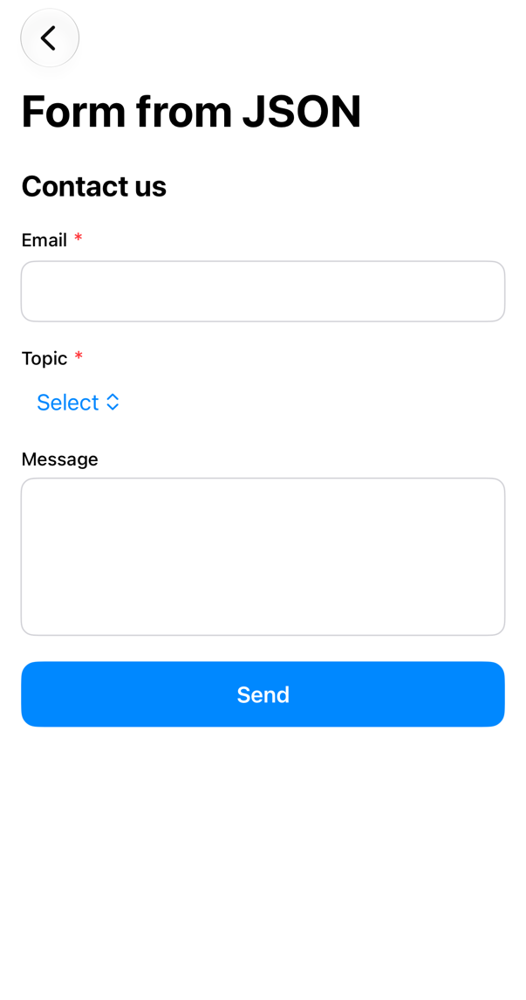
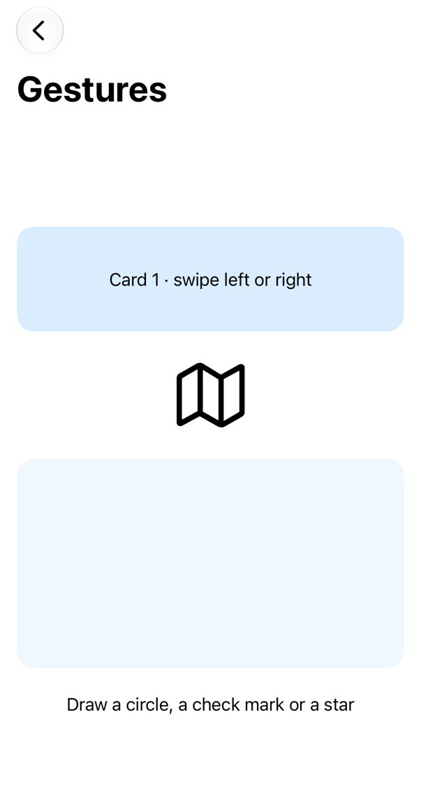
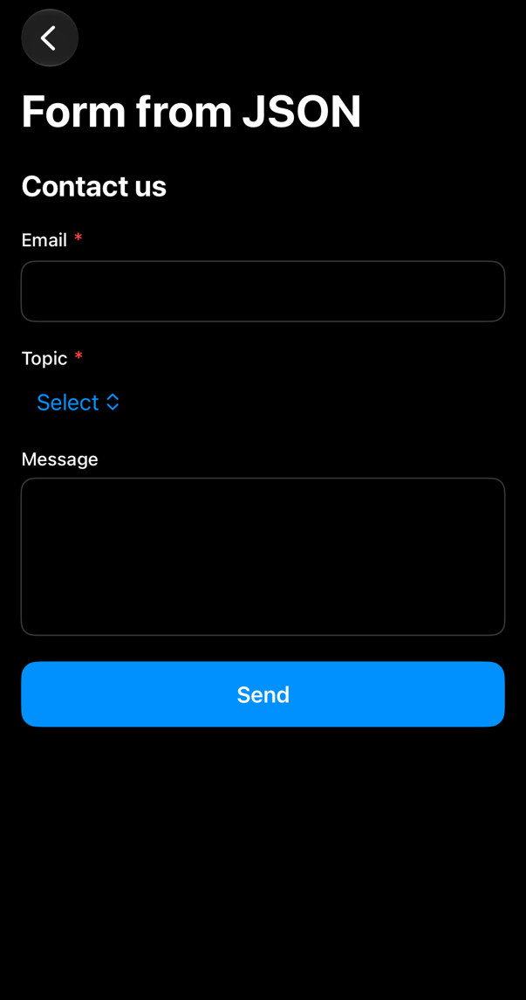
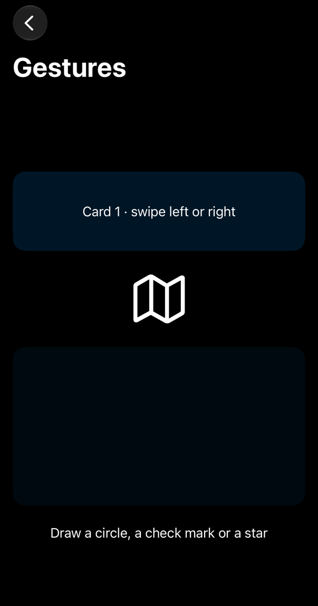

<!-- i18n-source: README.md@81a0529e2214c577e9e6fdc13d1be417a380b8f6 status=reviewed -->
<!-- brand:start -->

<p align="center"><picture><source media="(prefers-color-scheme: dark)" srcset="https://raw.githubusercontent.com/muhittincamdali/SwiftUI-Components/main/.github/brand/banner-ja-dark.svg"><source media="(prefers-color-scheme: light)" srcset="https://raw.githubusercontent.com/muhittincamdali/SwiftUI-Components/main/.github/brand/banner-ja-light.svg"></picture></p>

<!-- lang-selector:start -->
<p align="center"><a href="README.md">English</a> · <a href="README.tr.md">Türkçe</a> · <a href="README.zh-CN.md">简体中文</a> · <a href="README.ja.md">日本語</a> · <a href="README.ko.md">한국어</a> · <a href="README.es.md">Español</a> · <a href="README.de.md">Deutsch</a> · <a href="README.fr.md">Français</a> · <a href="README.pt-BR.md">Português (Brasil)</a> · <a href="README.ru.md">Русский</a></p>
<!-- lang-selector:end -->

<p align="center">
<a href="https://github.com/muhittincamdali/SwiftUI-Components/actions/workflows/ci.yml"></a>
<a href="https://github.com/muhittincamdali/SwiftUI-Components/releases"><picture><source media="(prefers-color-scheme: dark)" srcset="https://raw.githubusercontent.com/muhittincamdali/SwiftUI-Components/main/.github/brand/badge-version-dark.svg"><source media="(prefers-color-scheme: light)" srcset="https://raw.githubusercontent.com/muhittincamdali/SwiftUI-Components/main/.github/brand/badge-version-light.svg"></picture></a>
<a href="https://github.com/muhittincamdali/SwiftUI-Components/blob/main/Package.swift"><picture><source media="(prefers-color-scheme: dark)" srcset="https://raw.githubusercontent.com/muhittincamdali/SwiftUI-Components/main/.github/brand/badge-platforms-dark.svg"><source media="(prefers-color-scheme: light)" srcset="https://raw.githubusercontent.com/muhittincamdali/SwiftUI-Components/main/.github/brand/badge-platforms-light.svg"></picture></a>
<a href="https://github.com/muhittincamdali/SwiftUI-Components/blob/main/Package.swift"><picture><source media="(prefers-color-scheme: dark)" srcset="https://raw.githubusercontent.com/muhittincamdali/SwiftUI-Components/main/.github/brand/badge-language-dark.svg"><source media="(prefers-color-scheme: light)" srcset="https://raw.githubusercontent.com/muhittincamdali/SwiftUI-Components/main/.github/brand/badge-language-light.svg"></picture></a>
<a href="https://github.com/muhittincamdali/SwiftUI-Components/blob/main/LICENSE"><picture><source media="(prefers-color-scheme: dark)" srcset="https://raw.githubusercontent.com/muhittincamdali/SwiftUI-Components/main/.github/brand/badge-license-dark.svg"><source media="(prefers-color-scheme: light)" srcset="https://raw.githubusercontent.com/muhittincamdali/SwiftUI-Components/main/.github/brand/badge-license-light.svg"></picture></a>
</p>

<p align="center">
<a href="#クイックスタート"><picture><source media="(prefers-color-scheme: dark)" srcset="https://raw.githubusercontent.com/muhittincamdali/SwiftUI-Components/main/.github/brand/button-start-ja-dark.svg"><source media="(prefers-color-scheme: light)" srcset="https://raw.githubusercontent.com/muhittincamdali/SwiftUI-Components/main/.github/brand/button-start-ja-light.svg"></picture></a>
<a href="https://muhittincamdali.github.io/SwiftUI-Components/documentation/swiftuicomponents/"><picture><source media="(prefers-color-scheme: dark)" srcset="https://raw.githubusercontent.com/muhittincamdali/SwiftUI-Components/main/.github/brand/button-docs-ja-dark.svg"><source media="(prefers-color-scheme: light)" srcset="https://raw.githubusercontent.com/muhittincamdali/SwiftUI-Components/main/.github/brand/button-docs-ja-light.svg"></picture></a>
<a href="https://github.com/muhittincamdali/SwiftUI-Components/tree/main/Examples"><picture><source media="(prefers-color-scheme: dark)" srcset="https://raw.githubusercontent.com/muhittincamdali/SwiftUI-Components/main/.github/brand/button-examples-ja-dark.svg"><source media="(prefers-color-scheme: light)" srcset="https://raw.githubusercontent.com/muhittincamdali/SwiftUI-Components/main/.github/brand/button-examples-ja-light.svg"></picture></a>
</p>

> このドキュメントは英語版 README の翻訳です。内容が異なる場合は英語版が最新です。

<!-- brand:end -->

iOS 17 以降と macOS 14 以降向けの、すぐに使える SwiftUI ビューをまとめた Swift パッケージです。ボタン、カード、チャート、検証付きのフォーム入力、ジェスチャー、リスト、オーバーレイ、ローディング表示、トーストを含みます。コンポーネントを一から作るのではなく、動くものを今すぐ使いたいアプリ開発者に向けています。どのコンポーネントもイニシャライザで設定する普通の SwiftUI `View` なので、テーマシステムや特定のアーキテクチャを導入しなくても、必要な 1 つか 2 つだけを使えます。パッケージに依存関係はありません。

## 主な特長

- **223 個のビュー、12 個のビュー modifier、5 個のジェスチャー modifier**：ソースコードから数えた数で、下の 14 のカテゴリに分かれています。`PrimaryButton` から `CreditCardInput`、`SchemaForm`、`ShapeDrawingPad` まで揃っています。
- **自分でチェックするフォーム**：組み合わせ可能なバリデータ、最初の編集のあとに表示されるエラー、デバウンスされたサーバー側のチェック、JSON から描画するフォーム、複数ステップのフロー。JSON スキーマ内のパターンは時間制限つきで実行され、遅いパターンはアプリを固まらせる代わりにその値を不合格にします。
- **アクセシブルなジェスチャー**：スワイプ、画面端からのスワイプ、スワイプの連続操作、ピンチ・回転・ドラッグ、図形の描画に対応し、どれにも VoiceOver や Switch Control を使う人向けのアクセシビリティアクションがあります。
- **1 つのコードベースで iOS と macOS に対応**：UIKit にしかない部分は最も近い AppKit の動作に置き換わります。[プラットフォームの違い](Sources/SwiftUIComponents/SwiftUIComponents.docc/PlatformDifferences.md)に一覧があります。
- **Swift 6 言語モード**：厳格な並行性チェックのもとで、警告なしにビルドできます。
- **テスト済みのロジック**：カード番号の判定と Luhn チェック、有効期限、電話番号の整形、バリデータ、JSON スキーマ、ステップのフロー、スワイプと図形の認識、コントラスト比、`FlowLayout` の折り返し、チャートの図形計算、ページング、トーストのキューを、macOS と iPhone シミュレータで実行する 163 個の Swift Testing テストで確認しています。
- **コンパイルされる使用例**：「使い方」のコード例はすべて、CI が iOS と macOS 向けにビルドする [サンプルアプリ](Examples/ComponentGallery)から取っています。

### 含まれるもの

| カテゴリ         | 例                                                                                                                                               |
| ------------ | ----------------------------------------------------------------------------------------------------------------------------------------------- |
| ボタン (25)     | `PrimaryButton`, `SecondaryButton`, `LoadingButton`, `GradientButton`, `PillButton`, `FloatingActionButton`, `SplitButton`, `ToggleButtonGroup` |
| カード (27)     | `CardView`, `StatCard`, `PricingCard`, `ProfileCard`, `ProductCard`, `FlipCard`, `ExpandableCard`, `TestimonialCarousel`                        |
| チャート (19)    | `BarChart`, `LineChart`, `AreaChart`, `PieChart`, `DonutChart`, `GaugeChart`, `RingChart`, `SparklineChart`                                     |
| フォーム (23)    | `FormField`, `TextInputField`, `PasswordField`, `SelectField`, `SliderField`, `OTPField`, `FileUploadField`, `SchemaForm`, `MultiStepForm`      |
| 入力 (13)      | `CreditCardInput`, `PhoneInput`, `PinInput`, `TimedPinInput`, `RatingInput`, `SearchBar`, `TagInput`                                            |
| リスト (18)     | `InfiniteScrollList` + `PaginatedListViewModel`, `ExpandableList`, `TreeView`, `SwipeableRow`, `ReorderableList`                                |
| ローディング (16)  | `ProgressRing`, `SkeletonView`, `ShimmerView`, `DotLoader`, `PulseLoader`, `StateView`, `AsyncContentView`                                      |
| ナビゲーション (19) | `SegmentedControl`, `StepsIndicator`, `PageIndicator`, `BreadcrumbView`, `CustomTabBar`, `SideMenu`                                             |
| オーバーレイ (13)  | `BottomSheet`, `AlertDialog`, `ConfirmationDialog`, `ModalView`, `Tooltip`, `PopoverView`                                                       |
| テキスト (17)    | `HighlightedText`, `ExpandableText`, `TypewriterText`, `MarqueeText`, `AnimatedCounter`, `GradientText`                                         |
| トースト (4)     | `ToastView`, `SnackBar` + `SnackBarManager`, `Banner` + `BannerManager`                                                                         |
| その他 (27)     | `Avatar`, `Badge`, `Chip`, `Tag`, `Carousel`, `Accordion`, `CountdownTimer`, `Stopwatch`                                                        |
| 空の状態 (1)     | `EmptyStateView`                                                                                                                                |
| ジェスチャー (1)   | `ShapeDrawingPad`、および下記の modifier と `UnistrokeRecognizer`                                                                                       |

レイアウトと modifier：`FlowLayout`（折り返しレイアウト）、`.surface()`、`.shimmer()`、`.toast(isPresenting:message:)`、`.snackBarHost()`、`.bannerHost()`。

ジェスチャーの modifier：`.onSwipe(_:perform:)`、`.onEdgeSwipe(from:accessibilityActionName:perform:)`、`.onSwipeSequence(_:within:perform:)`、`.transformable(_:scaleRange:)`、`.boundedDrag(offset:in:)`。

検証（ビューではないもの）：`Validator`、`ValidatedValue`、`AsyncValidation`、`FormSchema`、`StepFlow`、`ColorContrast`（WCAG のコントラスト比）。

## クイックスタート

**1. パッケージを追加する**

Xcode で **File › Add Package Dependencies…** を選び、リポジトリの URL を入力します。

```text
https://github.com/muhittincamdali/SwiftUI-Components.git
```

URL はウィンドウ右上の検索フィールドに貼り付けます。**Dependency Rule** は **Up to Next Major Version**、バージョンは `2.1.0` のままにして **Add Package** をクリックします。次のウィンドウで **SwiftUIComponents** の横にあるアプリのターゲットを選び、もう一度 **Add Package** をクリックします。

**2. モジュールをインポートする**

```swift
import SwiftUIComponents
```

この行は、コンポーネントを使う Swift ファイルの先頭、`import SwiftUI` の下に書きます。

**3. 使ってみる**

新しい Xcode アプリ（**File › New › Project… › App**）で、`ContentView.swift` の中身をすべて次のコードに置き換えます。

```swift
import SwiftUI
import SwiftUIComponents

struct ContentView: View {
    @State private var rating = 3.0

    var body: some View {
        VStack(spacing: 20) {
            Text("Rate this app")
                .font(.headline)
            RatingInput(rating: $rating)
            PrimaryButton("Send rating") {
                print("Rating: \(rating)")
            }
        }
        .padding()
    }
}
```

**Run**（⌘R）を押します。5 つの星と青いボタンが表示されます。星をタップすると評価が変わり、ボタンをタップすると評価が Xcode のコンソールに出力されます。

## インストール

### Swift Package Manager

Xcode で **File › Add Package Dependencies…** を選び、リポジトリの URL を入力します。

```text
https://github.com/muhittincamdali/SwiftUI-Components.git
```

または `Package.swift` の `dependencies` に追加します。

```swift
dependencies: [
    .package(url: "https://github.com/muhittincamdali/SwiftUI-Components.git", from: "2.1.0")
],
targets: [
    .target(name: "YourApp", dependencies: [
        .product(name: "SwiftUIComponents", package: "SwiftUI-Components")
    ])
]
```

バージョン 2.0.0（2026 年 10 月）は、現在のコンポーネントを含む最初のリリースです。それ以前のリリースである 1.0.0（2026 年 2 月）は現在のコンポーネントより前のものです。2026 年 6 月にコンポーネントはプレースホルダーのコードに置き換えられ、2026 年 10 月に復元されました。その際、Swift 6 言語モードで iOS と macOS 向けにビルドできるようにし、新しいテストで見つかった不具合を修正しています。互換性のない変更を含む詳細は [CHANGELOG.md](CHANGELOG.md) を参照してください。

## 使い方

以下のサンプルは [`Examples/ComponentGallery/ComponentGallery/ReadmeSamples.swift`](Examples/ComponentGallery/ComponentGallery/ReadmeSamples.swift) からコピーしたものです。このファイルはサンプルアプリとテストスイートの両方でコンパイルされます。

### ボタン

```swift
struct CheckoutButtons: View {
    @State private var payState: LoadingButton.LoadingState = .idle

    var body: some View {
        VStack(spacing: 12) {
            PrimaryButton("Continue") {
                print("Continue tapped")
            }

            LoadingButton("Pay $9.99", state: $payState) {
                try? await Task.sleep(for: .seconds(1))
                return true // false shows the failure state
            }
        }
        .padding()
    }
}
```

### チャート

```swift
struct WeeklyStats: View {
    var body: some View {
        VStack(spacing: 24) {
            BarChart(data: [
                .init(value: 32, label: "Mon"),
                .init(value: 45, label: "Tue"),
                .init(value: 28, label: "Wed"),
            ])
            .frame(height: 180)

            SparklineChart(data: [3, 5, 4, 7, 6, 9], style: .gradient, lineColor: .purple)
                .frame(height: 50)
        }
        .padding()
    }
}
```

### 支払いフォーム

`CreditCardInput` は入力に合わせて番号を整形し、カードブランドを判定して、番号（Luhn）、有効期限、CVV の桁数、カード名義人の名前を検証します。

```swift
struct PaymentForm: View {
    @State private var number = ""
    @State private var expiry = ""
    @State private var cvv = ""
    @State private var name = ""
    @State private var canPay = false

    var body: some View {
        VStack {
            CreditCardInput(
                cardNumber: $number,
                expiryDate: $expiry,
                cvv: $cvv,
                cardholderName: $name,
                onValidationChange: { canPay = $0 }
            )
            PrimaryButton("Pay", isDisabled: !canPay) {}
        }
        .padding()
    }
}
```

整形と検証のヘルパーは public なので、ほかの場所でも使えます。

```swift
let type = CreditCardInput.CardType.detect(from: "3782 822463 10005") // .amex
let pretty = CreditCardInput.formatCardNumber("378282246310005")     // "3782 822463 10005"
let valid = CreditCardInput.isLuhnValid("378282246310005")           // true
```

### スナックバー

```swift
struct InboxScreen: View {
    var body: some View {
        List {
            Button("Archive") {
                SnackBarManager.shared.show(message: "Conversation archived", style: .success)
            }
        }
        .snackBarHost()
    }
}
```

スナックバーはキューに入り、1 つずつ表示されます。`BannerManager` も `.bannerHost()` と組み合わせて同じように使えますが、新しいバナーは表示中のバナーを置き換えます。

### フローレイアウト

```swift
struct TopicPicker: View {
    let topics = ["SwiftUI", "Combine", "Concurrency", "Testing", "Accessibility"]

    var body: some View {
        FlowLayout(spacing: 8) {
            ForEach(topics, id: \.self) { topic in
                Tag(topic)
            }
        }
    }
}
```

### 検証付きフォーム

```swift
struct SignUpForm: View {
    @State private var email = ValidatedValue("", .required().and(.email()))
    @State private var password = ValidatedValue("", .required().and(.minLength(8)))

    var body: some View {
        VStack(spacing: 16) {
            FormField(label: "Email", errorMessage: email.visibleError) {
                TextInputField(text: $email.value, placeholder: "you@example.com", keyboardType: .email)
            }
            FormField(label: "Password", errorMessage: password.visibleError) {
                PasswordField(password: $password.value)
            }
            PrimaryButton("Create account") {
                let emailIsValid = email.validate()     // shows the errors of untouched fields
                let passwordIsValid = password.validate()
                if emailIsValid && passwordIsValid {
                    print("Signing up \(email.value)")
                }
            }
        }
        .padding()
    }
}
```

`ValidatedValue` は、ユーザーがフィールドを編集するか、ボタンをタップした後にだけエラーを表示します。バリデータは `.and(_:)` で組み合わせられます。テキスト用のバリデータには `required`、`minLength`、`email`、`url`、`phone`、`digits`、`matches`（正規表現）があり、`AsyncValidation` は「このユーザー名は使用済みか」のようなサーバー側のチェックをデバウンスします。

### JSON から作るフォーム

フィールドをデータとして記述します。たとえば、サーバーからのレスポンスに含めます。

```swift
let contactFormJSON = """
{
  "title": "Contact us",
  "fields": [
    { "id": "email", "label": "Email", "kind": "email", "required": true },
    { "id": "topic", "label": "Topic", "kind": "choice", "options": ["Sales", "Support"], "required": true },
    { "id": "message", "label": "Message", "kind": "multiline", "minLength": 10 }
  ]
}
"""
```

デコードします。このとき、ID の重複、成り立たない制限、無効な正規表現を含むスキーマや、フィールド・パターン・選択肢の数がサイズ上限を超えるスキーマは拒否されます。

```swift
func loadContactSchema() throws -> FormSchema {
    try FormSchema.decode(from: Data(contactFormJSON.utf8)) // throws for malformed JSON
}
```

続いて表示し、値は自分の state に保持します。

```swift
struct ContactForm: View {
    let schema: FormSchema
    @State private var values: [String: FormValue]
    @State private var submitted = false

    init(schema: FormSchema) {
        self.schema = schema
        _values = State(initialValue: schema.initialValues())
    }

    var body: some View {
        VStack(spacing: 20) {
            SchemaForm(schema: schema, values: $values, showsAllErrors: submitted)
            PrimaryButton("Send") {
                submitted = true
                if schema.errors(in: values).isEmpty {
                    print(values) // ["email": .text("ada@example.com"), ...]
                }
            }
        }
        .padding()
    }
}
```

パターンは `NSRegularExpression` の構文を使います。20 ms を超えた照合は打ち切られてその値は不合格になり、UTF-16 コード単位で 1,000 を超えるテキストは照合せずに不合格になります。また、1 回の `errors(in:)` がパターンに使う時間は最大 100 ms です。そのため、サーバーから届いた遅いパターンでもフォームは固まりません。

`MultiStepForm` と `StepFlow` を使うと、長いフォームを複数のステップに分けられ、現在のステップが有効になるまで **Next** は無効のままになります。

### ジェスチャー

```swift
struct GestureDemo: View {
    @State private var card = 1
    @State private var zoom = TransformState.identity
    @State private var drawing = "Draw a circle, a check mark or a star"

    var body: some View {
        VStack(spacing: 24) {
            Text("Card \(card) · swipe left or right")
                .frame(maxWidth: .infinity, minHeight: 100)
                .background(.blue.opacity(0.15), in: .rect(cornerRadius: 16))
                .onSwipe([.left, .right]) { direction in
                    card += direction == .left ? 1 : -1
                }

            Image(systemName: "map")
                .font(.system(size: 64))
                .transformable($zoom, scaleRange: 1...5) // pinch, rotate, drag; double tap resets

            ShapeDrawingPad { match in
                drawing = match.map { "That looks like a \($0.name)" } ?? "Not sure, try again"
            }
            .frame(height: 200)
            .background(.blue.opacity(0.06), in: .rect(cornerRadius: 16))
            Text(drawing)
        }
        .padding()
    }
}
```

どのジェスチャーにもアクセシビリティアクションがあります。VoiceOver ユーザーにはアクションのローターに **Swipe left** と **Swipe right** が表示され、地図はシステムのズーム操作で拡大でき、`ShapeDrawingPad(accessibilityAlternatives:)` は図形ごとに名前付きのアクションを追加します。残りのケースは `onEdgeSwipe`、`onSwipeSequence`、`boundedDrag` が担当します。

### コントラストの確認

```swift
func contrastCheck() {
    let ratio = ColorContrast.ratio(.white, Color(red: 0, green: 0.443, blue: 0.890)) // #0071E3
    let level = ColorContrast.level(for: ratio) // .aa: fine for body text
    print(ratio, level)
}
```

`ColorContrast` は、2 つの色の WCAG 2 コントラスト比と、満たしているレベル（AA、大きい文字向けの AA、または AAA）を計算します。

## デモ

| ライト                                               | ダーク                                              |
| ------------------------------------------------- | ------------------------------------------------ |
|         |         |
|           |           |
|         |         |
|  |  |

スクリーンショットは [`scripts/generate-screenshots.sh`](scripts/generate-screenshots.sh) が iOS シミュレータ上で [`Tests/SwiftUIComponentsTests/Gallery.swift`](Tests/SwiftUIComponentsTests/Gallery.swift) から描画したものです。

「使い方」のフォームとジェスチャーを、[`scripts/capture-example-screens.sh`](scripts/capture-example-screens.sh) でサンプルアプリから iPhone シミュレータ上でキャプチャしたものです。

| 検証付きフォーム                                               | JSON から作るフォーム                                                    | ジェスチャー                                                 |
| ------------------------------------------------------ | ---------------------------------------------------------------- | ------------------------------------------------------ |
|  |  |  |
|   |   |   |

自分で試すには、[`Examples/ComponentGallery`](Examples/ComponentGallery) にある `ComponentGallery.xcodeproj` を Xcode で開き、iPhone シミュレータか **My Mac** を選んで **Run** を押します。アプリには上のサンプルごとに画面があります。詳しくは [Examples/README.md](Examples/README.md) を参照してください。

## ドキュメント

API リファレンスと解説記事：

- [API リファレンス](https://muhittincamdali.github.io/SwiftUI-Components/documentation/swiftuicomponents/)（DocC。`main` ブランチから GitHub Pages に公開）
- ローカルでは Xcode の **Product › Build Documentation**、またはコマンドラインでビルドできます。

```sh
xcodebuild docbuild -scheme SwiftUIComponents -destination 'generic/platform=macOS'
```

## ガイド

- [Getting Started](https://muhittincamdali.github.io/SwiftUI-Components/documentation/swiftuicomponents/gettingstarted)：パッケージの追加、コンポーネントの配置、スナックバーの表示、リストのページング（[ソース](Sources/SwiftUIComponents/SwiftUIComponents.docc/GettingStarted.md)）。
- [Collecting Card Details](https://muhittincamdali.github.io/SwiftUI-Components/documentation/swiftuicomponents/collectingcarddetails)：検証付きの支払いフォームと、チェックで分かること・分からないこと（[ソース](Sources/SwiftUIComponents/SwiftUIComponents.docc/CollectingCardDetails.md)）。
- [Validating Forms](https://muhittincamdali.github.io/SwiftUI-Components/documentation/swiftuicomponents/validatingforms)：バリデータ、適切なタイミングでのエラー表示、サーバー側のチェック、JSON から作るフォーム、複数ステップのフォーム（[ソース](Sources/SwiftUIComponents/SwiftUIComponents.docc/ValidatingForms.md)）。
- [Adding Gestures](https://muhittincamdali.github.io/SwiftUI-Components/documentation/swiftuicomponents/addinggestures)：スワイプ、ピンチ・回転・ドラッグ、図形の認識と、それらのアクセシビリティアクション（[ソース](Sources/SwiftUIComponents/SwiftUIComponents.docc/AddingGestures.md)）。
- [Platform Differences](https://muhittincamdali.github.io/SwiftUI-Components/documentation/swiftuicomponents/platformdifferences)：macOS で変わる点（[ソース](Sources/SwiftUIComponents/SwiftUIComponents.docc/PlatformDifferences.md)）。

記事は英語です。

## 動作要件

| プラットフォーム | 最小バージョン               |
| -------- | --------------------- |
| iOS      | 17                    |
| macOS    | 14                    |
| ツールチェーン  | Swift 6.2 · Xcode 26+ |

CI は GitHub の `macos-26` runner イメージに入っている既定の Xcode でビルドします。開発には Xcode 27 を使っています。

## アーキテクチャ

- `Sources/SwiftUIComponents/<Category>/` には、コンポーネントのファミリーごとに 1 つのファイルがあります。コンポーネントは状態を `@State` と `@Binding` に持ちます。参照型は `SnackBarManager`、`BannerManager`、`PaginatedListViewModel`、`AsyncValidation` の 4 つだけで、いずれも `@MainActor` です。
- 検証とジェスチャーの判定は、ビューのコードを含まない値型（`Validator`、`FormSchema`、`StepFlow`、`SwipeDirection`、`SwipeSequenceMatcher`、`TransformState`、`UnistrokeRecognizer`）で行うため、modifier は薄いままで、ルールは単体テストで確認できます。
- `Extensions/Platform.swift` は、UIKit にしかない少数の API（システムカラー、触覚フィードバック、キーボードの種類、自動大文字化、ホイールピッカー、ページ式の `TabView`）を AppKit の機能か何もしない処理に対応させます。そのため、コンポーネント自体にはほとんど `#if os(...)` がありません。
- 画面なしでテストできるロジックは static 関数かマネージャークラスに置き、`Tests/` の Swift Testing スイートで確認しています。`RenderTests` と `GaugeNeedleTests` は `ImageRenderer` でビューを描画します。ギャラリーの各ページをライトモードとダークモードで描画し（クラッシュするビューやサイズがゼロになるビューを検出）、ゲージの針の向きも確認します。個々のビューの多くには専用のテストがありません。
- CI は macOS で `swift test` を、iPhone シミュレータで `xcodebuild test` を実行し、サンプルアプリを iOS と macOS 向けにビルドして、DocC ドキュメントを公開します。

ローカルでテストを実行するには：

```sh
swift test                                    # macOS
xcodebuild test -scheme SwiftUIComponents \
  -destination 'platform=iOS Simulator,name=iPhone 17'
```

## ロードマップ

- パッケージを Swift Package Index に登録する。`.spi.yml` はすでにリポジトリにあります。
- フォーム入力から始めて、個々のビューのテストを増やす。
- `FormSchema` に条件付きフィールドを追加する（別のフィールドの値に応じてフィールドを表示する）。

## コントリビューション

コントリビューションを歓迎します。pull request を作成する前に[コントリビューションガイド](https://github.com/muhittincamdali/SwiftUI-Components/blob/main/CONTRIBUTING.md)と[行動規範](https://github.com/muhittincamdali/.github/blob/main/CODE_OF_CONDUCT.md)をお読みください。セキュリティ上の問題は[セキュリティポリシー](https://github.com/muhittincamdali/.github/blob/main/SECURITY.md)に従って非公開で報告してください。

## ライセンス

MIT ライセンスで公開しています。詳細は [LICENSE](LICENSE) を参照してください。
